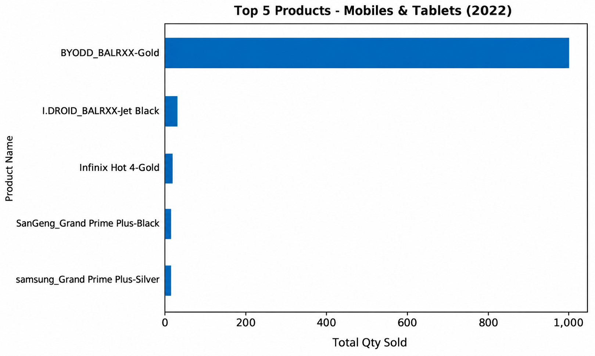
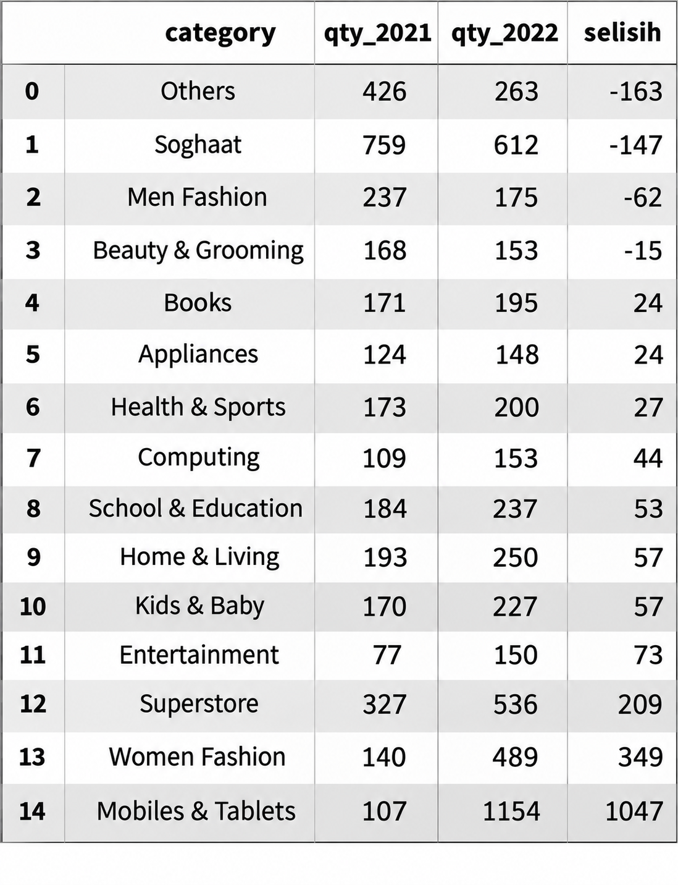
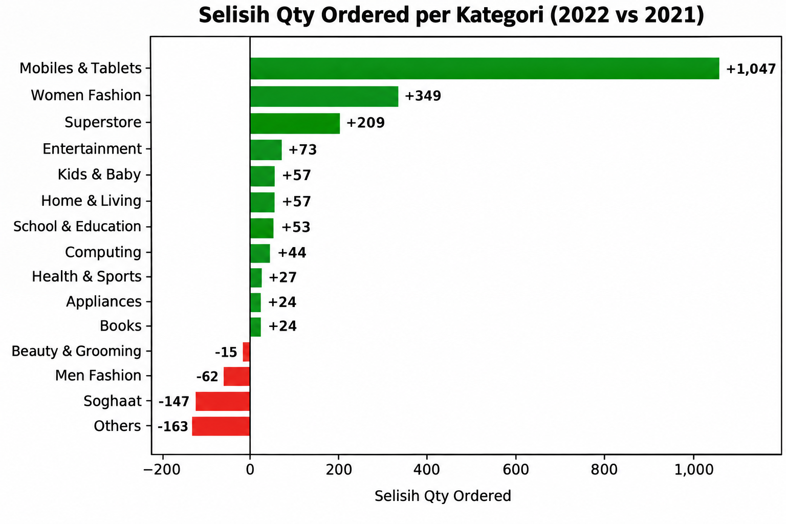
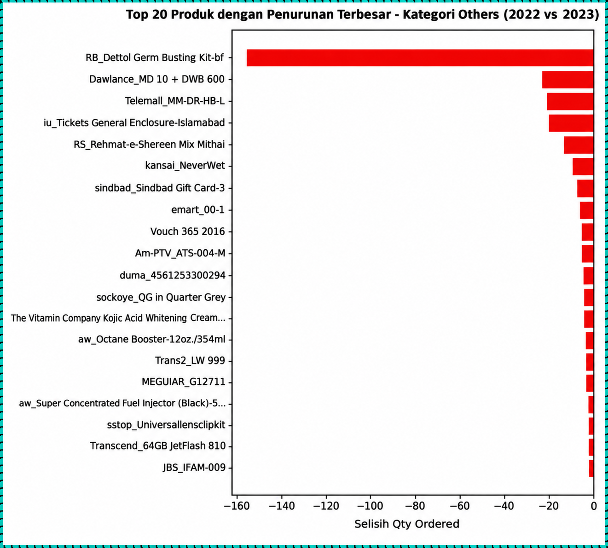
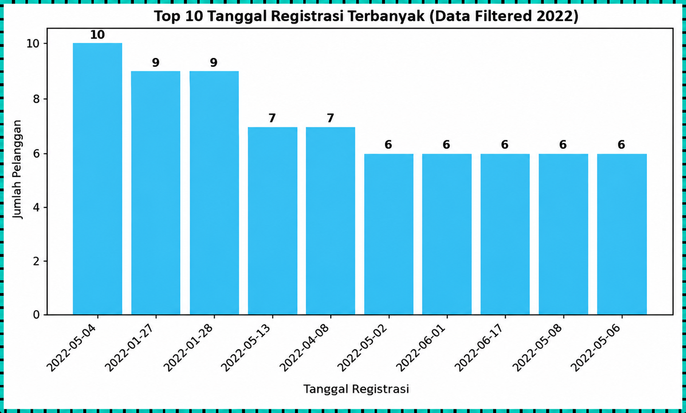
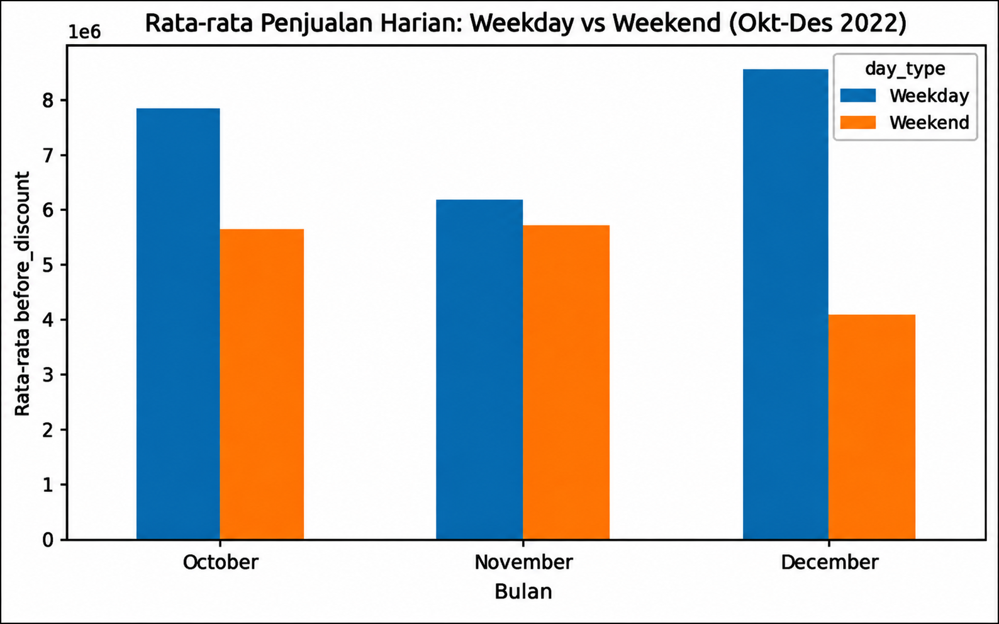
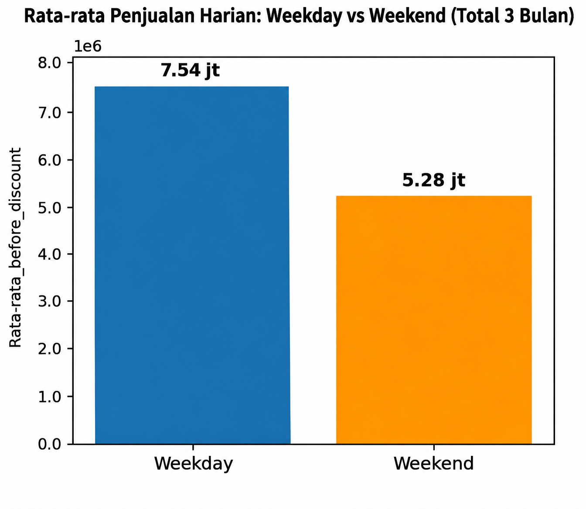

# tokopaedi-sales-analysis | Python (Google Colab)

## Gambaran Proyek

Proyek ini berisi latihan pengolahan dan analisis data transaksi e-commerce **Tokopaedi** menggunakan **Python** di **Google Colab**. Di proyek ini saya mengolah data dari tahun 2021 hingga 2022 untuk menjawab beberapa pertanyaan dari tim internal perusahaan (Marketing, Warehouse, dan Campaign).

Ada 4 kasus utama yang dianalisis di proyek ini:

* **Kasus 1 (Request Tim Marketing):** Mencari 5 produk terlaris di kategori *Mobiles & Tablets* selama tahun 2022 sebagai referensi hadiah promosi akhir tahun.

* **Kasus 2 (Request Tim Warehouse):** Mengecek perbandingan jumlah barang terjual per kategori antara tahun 2021 dan 2022, serta mencari 20 produk di kategori *Others* yang mengalami penurunan penjualan paling banyak.

* **Kasus 3 (Request Tim Digital Marketing):** Mengambil daftar pelanggan (`customer_id` dan `registered_date`) yang sudah *checkout* tapi belum menyelesaikan pembayaran (`is_gross = 1`, `is_valid = 0`, `is_net = 0`) selama tahun 2022 untuk diberikan promo ulang tahun perusahaan.

* **Kasus 4 (Request Tim Campaign):** Membandingkan rata-rata penjualan harian saat akhir pekan (*Weekend*) dan hari kerja (*Weekday*) pada bulan Oktober–Desember 2022 untuk mengevaluasi hasil kampanye iklan hari Sabtu-Minggu.

Tools yang dipakai: **Python** (`pandas`, `numpy`, `matplotlib`, `seaborn`) di Google Colab.

## **Daftar Isi**

* [Data yang Digunakan](#data-yang-digunakan)

* [Hasil Analisis](#hasil-analisis)

* [Kesimpulan Singkat](#kesimpulan-singkat)

* [Saran](#saran)

## Data yang Digunakan

Dataset yang diolah terdiri dari 4 file CSV yang saling terhubung dan dapat diakses/diunduh langsung melalui tautan berikut:

1. [**`order_detail.csv`**](dataset/order_detail.csv) ([Raw CSV](https://raw.githubusercontent.com/fadhlulikram/tokopaedi-sales-analysis-Python-Google-Colab-/refs/heads/main/dataset/order_detail.csv)): Menyimpan data transaksi pesanan (`id`, `customer_id`, `order_date`, `sku_id`, `price`, `qty_ordered`, `before_discount`, `discount_amount`, `after_discount`, `is_gross`, `is_valid`, `is_net`, `payment_id`).

2. [**`sku_detail.csv`**](dataset/sku_detail.csv) ([Raw CSV](https://raw.githubusercontent.com/fadhlulikram/tokopaedi-sales-analysis-Python-Google-Colab-/refs/heads/main/dataset/sku_detail.csv)): Menyimpan informasi detail produk (`id`, `sku_name`, `base_price`, `cogs`, `category`).

3. [**`customer_detail.csv`**](dataset/customer_detail.csv) ([Raw CSV](https://raw.githubusercontent.com/fadhlulikram/tokopaedi-sales-analysis-Python-Google-Colab-/refs/heads/main/dataset/customer_detail.csv)): Menyimpan data tanggal registrasi pelanggan (`id`, `registered_date`).

4. [**`payment_detail.csv`**](dataset/payment_detail.csv) ([Raw CSV](https://raw.githubusercontent.com/fadhlulikram/tokopaedi-sales-analysis-Python-Google-Colab-/refs/heads/main/dataset/payment_detail.csv)): Menyimpan daftar metode pembayaran (`id`, `payment_method`).

Keterangan kolom status transaksi pada `order_detail`:

* **`is_gross = 1`**: Pelanggan baru memasukkan barang ke checkout (belum bayar).

* **`is_valid = 1`**: Pelanggan sudah melakukan pembayaran.

* **`is_net = 1`**: Transaksi sudah selesai sampai barang diterima.

## Hasil Analisis

### 1. Top 5 Produk Kategori Mobiles & Tablets (2022)

Untuk mencari produk paling laris sebagai referensi hadiah kompetisi akhir tahun, saya menggabungkan tabel `order_detail` dan `sku_detail`, menyaring transaksi tahun 2022 yang sudah dibayar (`is_valid = 1`) pada kategori *Mobiles & Tablets*, lalu menjumlahkan `qty_ordered`.

| Peringkat | SKU ID | Nama Produk | Total Terjual (Qty) | 
| ----- | ----- | ----- | ----- | 
| **1** | P313303 | IDROID_BALRX7-Gold | 1.000 | 
| **2** | P754831 | IDROID_BALRX7-Jet black | 31 | 
| **3** | P774890 | Infinix Hot 4-Gold | 15 | 
| **4** | P661542 | samsung_Grand Prime Plus-Black | 11 | 
| **5** | P592314 | samsung_Grand Prime Plus-Silver | 10 | 

<table>
  <tr>
    <td align="left" valign="top">
      
    </td>
  </tr>
</table>
**Temuan:**

* Penjualan di kategori ini sangat didominasi oleh satu produk yaitu **IDROID_BALRX7-Gold** yang terjual hingga **1.000 unit**, jauh di atas peringkat kedua yang hanya terjual 31 unit.

* Varian warna *Gold* muncul dua kali di posisi 3 besar, menunjukkan warna tersebut cukup diminati pembeli di tahun 2022.

### 2. Perbandingan Penjualan Kategori (2021 vs 2022) & Top 20 Produk Turun di Kategori Others

**2.1 Perbandingan 15 Kategori (2021 vs 2022):**
Saya mengelompokkan total kuantitas terjual (`is_valid = 1`) berdasarkan kategori untuk tahun 2021 dan 2022, lalu menghitung selisihnya (`qty_2022 - qty_2021`).

<table>
  <tr>
    <td align="left" valign="top">
      
    </td>
    <td align="right" valign="top">
      
    </td>
  </tr>
</table>

* **Kategori yang Paling Naik:** **Mobiles & Tablets** naik paling tinggi sebesar **+1.047 unit** (dari 107 menjadi 1.154 unit), diikuti oleh **Women Fashion** (**+349 unit**) dan **Superstore** (**+209 unit**).

* **Kategori yang Paling Turun:** Dugaan tim Warehouse terbukti benar. Kategori **Others** mengalami penurunan paling besar yaitu **-163 unit** (dari 426 menjadi 263 unit), disusul oleh **Soghaat** (**-147 unit**), **Men Fashion** (**-62 unit**), dan **Beauty & Grooming** (**-15 unit**).

**2.2 Top 20 Produk yang Paling Turun di Kategori Others:**
Setelah dicek lebih detail per nama produk di dalam kategori *Others*, penurunan terbesar terjadi pada produk **RB_Dettol Germ Busting Kit-bf** yang turun **-155 unit** (dari 200 unit di 2021 menjadi 45 unit di 2022).

<table>
  <tr>
    <td align="left" valign="top">
      
    </td>
  </tr>
</table>
Sementara itu, mayoritas produk lainnya di daftar 20 teratas mengalami penurunan sekitar 2 hingga 23 unit dan banyak yang tidak terjual sama sekali (`qty_2022 = 0`) di tahun 2022.

### 3. Data Pelanggan Belum Bayar (Checkout) di Tahun 2022

Untuk kebutuhan promo ulang tahun perusahaan, saya menggabungkan tabel `order_detail` dan `customer_detail`, lalu memfilter transaksi tahun 2022 dengan kondisi sudah checkout tapi belum bayar (`is_gross = 1`, `is_valid = 0`, dan `is_net = 0`).

<table>
  <tr>
    <td align="left" valign="top">
      
    </td>
  </tr>
</table>

**Temuan:**

* Setelah dihapus data duplikatnya (`drop_duplicates`), terdapat **820 pelanggan unik** yang sempat checkout namun batal/belum membayar pesanannya di tahun 2022.

* Jika dilihat dari tanggal registrasinya, pelanggan yang paling banyak mengalami transaksi menggantung ini mendaftar pada tanggal **4 Mei 2022** (10 pelanggan) serta **27–28 Januari 2022** (masing-masing 9 pelanggan).

### 4. Evaluasi Kampanye Penjualan Weekend vs Weekday (Oktober–Desember 2022)

Tim Campaign ingin melihat apakah kampanye iklan setiap hari Sabtu dan Minggu di kuartal akhir 2022 berhasil menaikkan rata-rata penjualan harian (`before_discount`) dibanding hari kerja (Senin–Jumat).

<table>
  <tr>
    <td align="left" valign="top">
      
    </td>
  </tr>
</table>

**Perbandingan Rata-rata Penjualan Harian per Bulan:**

| Bulan | Rata-rata Weekday (Rp) | Rata-rata Weekend (Rp) | Selisih (Rp) | Selisih (%) | 
| ----- | ----- | ----- | ----- | ----- | 
| **Oktober** | 7.872.212 | 5.708.341 | \-2.163.872 | \-27,49% | 
| **November** | 6.204.666 | 5.774.045 | \-430.621 | \-6,94% | 
| **Desember** | 8.542.530 | 4.105.994 | \-4.436.536 | \-51,93% | 
| **Total 3 Bulan** | **7.520.249** | **5.269.300** | **-2.250.949** | **-29,93%** | 

<table>
  <tr>
    <td align="right" valign="top">
      
    </td>
  </tr>
</table>

**Temuan:**

* Selama periode Oktober hingga Desember 2022, rata-rata penjualan harian di akhir pekan (**Weekend**) ternyata selalu lebih rendah dibanding hari kerja (**Weekday**) di ketiga bulan tersebut.

* Perbedaan paling jauh terjadi di bulan **Desember** (-51,93%), sedangkan di bulan **November** angkanya hampir berimbang (-6,94%).

* Secara keseluruhan selama 3 bulan, rata-rata penjualan harian *Weekend* (Rp5,26 juta) lebih rendah **29,93%** dibandingkan rata-rata *Weekday* (Rp7,52 juta).

## Kesimpulan Singkat

* **Produk Unggulan 2022:** Penjualan kategori *Mobiles & Tablets* melonjak tinggi di tahun 2022 terutama karena produk *IDROID_BALRX7-Gold* yang terjual 1.000 unit.

* **Penurunan Kategori Others:** Kategori *Others* mengalami penurunan penjualan paling tajam (-163 unit), yang sebagian besar disebabkan oleh turunnya permintaan produk paket kebersihan *RB_Dettol Germ Busting Kit-bf* (-155 unit) seiring meredanya masa pandemi.

* **Transaksi Menggantung:** Ada 820 pelanggan di tahun 2022 yang sudah memasukkan barang ke checkout tapi tidak menyelesaikan pembayaran.

* **Performa Campaign Weekend:** Kampanye di hari Sabtu–Minggu selama Oktober–Desember 2022 belum berhasil melampaui rata-rata penjualan di hari biasa (Senin–Jumat).

## Saran

* **Stok & Hadiah Akhir Tahun:** Pastikan stok *IDROID_BALRX7-Gold* aman jika ingin dijadikan hadiah utama atau produk promo bundling, namun tetap siapkan alternatif merek lain seperti Infinix dan Samsung di daftar Top 5.

* **Penataan Stok Gudang:** Kurangi pembelian stok baru untuk produk-produk di kategori *Others* yang sudah tidak ada peminatnya di 2022 (qty = 0), dan alihkan kapasitas gudang untuk kategori yang sedang naik seperti *Mobiles & Tablets* serta *Women Fashion*.

* **Follow-up Pelanggan Belum Bayar:** Kirimkan pesan pengingat (*reminder*) beserta voucher diskon ulang tahun perusahaan kepada 820 pelanggan yang belum menyelesaikan pembayarannya agar mereka tertarik melanjutkan transaksi.

* **Evaluasi Jadwal Campaign:** Karena transaksi pelanggan justru lebih ramai di hari kerja (*Weekday*), tim Campaign bisa mengalihkan sebagian anggaran promosi ke hari Senin–Jumat, atau mengevaluasi kembali jenis promo yang dipakai di bulan November (karena selisihnya paling kecil) untuk diterapkan di bulan lain.
